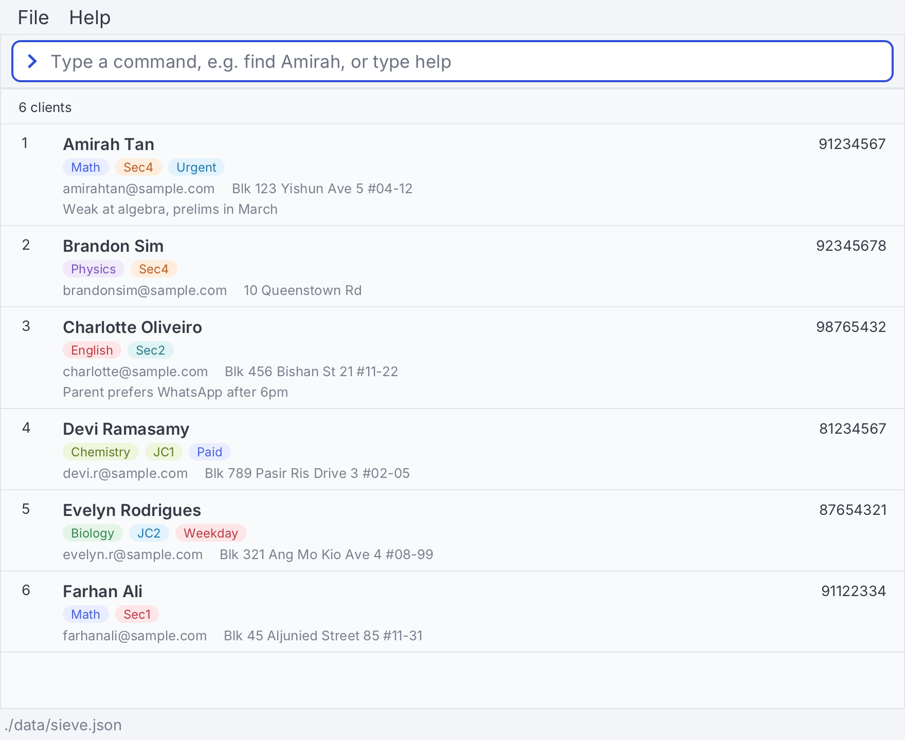

# Sieve

* **Sieve** is a desktop application designed for solo tutors running home-based lessons to manage client details quickly and efficiently.
* It features a powerful **Command Line Interface** (CLI) tailored for rapid, keyboard-oriented navigation, accompanied by a clean Graphical User Interface (GUI) layout.
* The application is cross-platform and runs seamlessly on Windows, macOS, and Linux.

## Key Features

* **Client Registry Management:** Quickly capture structured details including names, emails, physical lesson locations, and contact variables.
* **Singapore-Specific Validation:** Automatically checks phone numbers to ensure they match local 8-digit formats, preventing common typos.
* **Flexible Contact Handling:** Allows distinct client profiles to securely share identical phone numbers or emails, ensuring siblings or family units can coexist within the database.
* **Custom Dynamic Tagging:** Organise and label your students by subject matter, academic level, or scheduled lesson days using flexible, multi-tag assignments.
* **Reliable Core Workflows:** Find clients by typing the start of any part of their name, filter them by phone number or tag, delete several in one command, and undo mistakes.

## Acknowledgements
This project is based on the AddressBook-Level3 project created by the [SE-EDU initiative](https://se-education.org).

## Getting Started
For full installation details, advanced parameters, and command execution steps, please refer to the [User Guide](https://ay2627s1-cs2103t-t08-4.github.io/tp/UserGuide.html) on our [project website](https://ay2627s1-cs2103t-t08-4.github.io/tp/).
