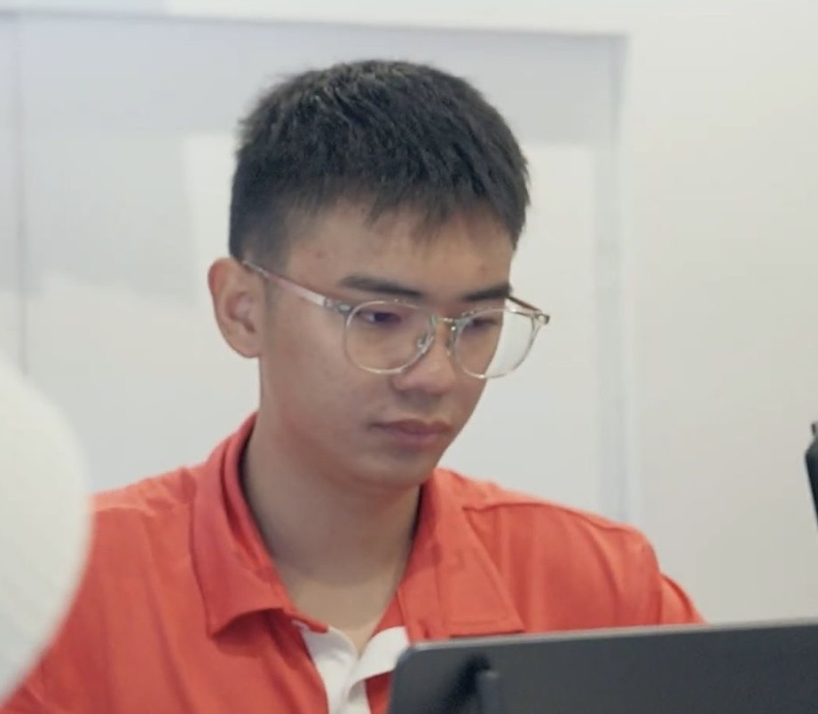
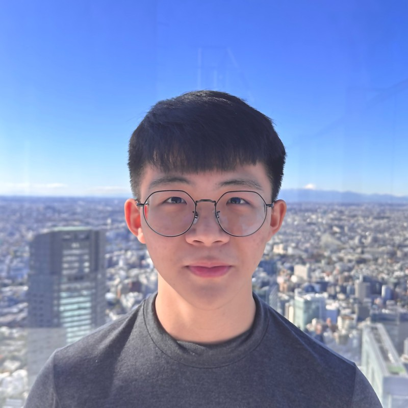

# About Us

We are a team based in the [School of Computing, National University of Singapore](http://www.comp.nus.edu.sg).

## Project team

### Ng Xu Xian

[[github](https://github.com/NgXuXian)]

* Role: Developer
* Responsibilities: Read-only mode, storage, fee and due date

### Xu Haocheng

[[github](https://github.com/Haocheeks)]

* Role: Developer
* Responsibilities: Undo and redo, command history, UI, input validation, releases

### Feng Yi

[[github](https://github.com/Jigusheng)]

* Role: Developer
* Responsibilities: Filter, tag, untag

### Jovan Lim

[[github](http://github.com/Matcha1atte1)]

* Role: Developer
* Responsibilities: Find, notes

### Jonathan Neo

[[github](http://github.com/neo-jonathann)]

* Role: Developer
* Responsibilities: Delete, help, dark theme, client detail panel
