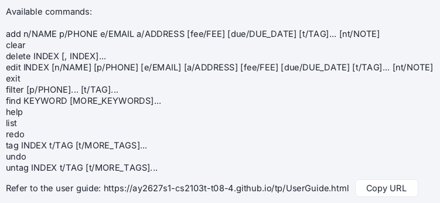
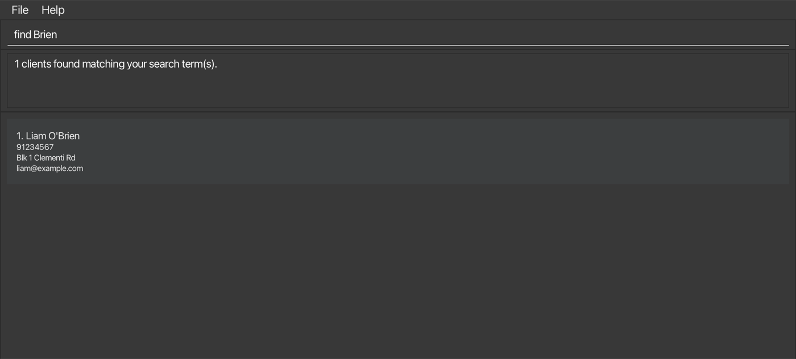

# Sieve User Guide

Sieve is a **desktop app that helps self-employed private tuition teachers keep track of their clients**. Sieve is optimised for use through a Command Line Interface (CLI) while still providing you with a Graphical User Interface (GUI) to your results. If you can type fast, Sieve lets you find and update any client's details quicker than hunting through chats, notes apps and spreadsheets, so you spend less time on admin and more time teaching.

<!-- * Table of Contents -->
<page-nav-print />

--------------------------------------------------------------------------------------------------------------------

## Quick start

1. Ensure that Java `25` or later is installed on your computer. 
   **Mac users:** Ensure you have the precise JDK version prescribed [here](https://se-education.org/guides/tutorials/javaInstallationMac.html).

1. Download the latest `.jar` file from [here](https://github.com/AY2627S1-CS2103T-T08-4/tp/releases).

1. Copy the file to the folder you want to use as the _home folder_ for Sieve.

1. Open a terminal, `cd` to the folder containing the JAR file, and run `java -jar sieve.jar`. 
   A GUI similar to the one below should appear in a few seconds. Note how the app contains some sample data. 
   

1. Type a command in the command box and press Enter to execute it. For example, type **`help`** and press Enter to open the help window. 
   Some example commands you can try:

   * `list` : Lists all clients.

   * `add n/Jason Quek p/91234567 e/jasonquek@gmail.com a/Blk 123 Yishun Ave 5 #04-12` : Adds a client named `Jason Quek` to Sieve.

   * `delete 3` : Deletes the 3rd client shown in the current list.

   * `clear` : Deletes all clients.

   * `exit` : Exits the app.

1. Refer to the [Features](#features) section below for details of each command.

--------------------------------------------------------------------------------------------------------------------

## Features

<box type="info" seamless>

**Notes about the command format:** 

* Words in `UPPER_CASE` are the parameters to be supplied by the user. 
  For example, in `add n/NAME`, replace `NAME` with a value such as `Amirah Tan`.

* Items in square brackets are optional. 
  For example, `n/NAME [t/TAG]` can be used as `n/Amirah Tan t/Math` or as `n/Amirah Tan`.

* Items followed by `...` can appear zero or more times. 
  For example, `[t/TAG]... ` may be omitted, or written as `t/Math` or `t/Math t/Sec4`.

* Parameters can be in any order, except the note (`nt/NOTE`), which must come last. 
  For example, if the command specifies `n/NAME p/PHONE`, `p/PHONE n/NAME` is also acceptable.

* In `add` and `edit`, a word that looks like a prefix but is not one, such as `z/` in `a/Blk 1 z/x`, is rejected as an unknown prefix, so that a mistyped prefix is not saved as part of a detail. 
  This applies to every parameter except the note, so a note such as `nt/Meet w/ parent` is fine. In an address, write `c/o` as `care of`.

* Extraneous parameters for `help`, `list` and `exit` are ignored. 
  For example, `help 123` is interpreted as `help`.

* `clear`, `undo` and `redo` take no parameters, and show an error if you add any. This stops `undo 3` from undoing only one change, and `clear 3` from deleting every client.

* If you are using a PDF version of this document, be careful when copying and pasting commands that span multiple lines as space characters surrounding line-breaks may be omitted when copied over to the application.
</box>

### Viewing a client's details

Click anywhere on a client's row to open their detailed information panel on the right. The client list becomes more
compact to make room for the panel, and the selected client remains highlighted.

The panel shows the client's name, tags, phone number, email address and address. It also shows their note, fee and due
date when those optional details have been recorded.

* Click another client to update the open panel without leaving the current screen.
* Click the **X** button at the top-right of the panel, or press **Esc**, to close it and restore the full-width list.
* If the selected client is edited, tagged or untagged, the open panel updates to show the latest details.
* If the selected client is deleted or no longer appears after a search or filter, the panel closes automatically.
* Opening and closing the panel does not change or save any client data. Use the [`edit`](#editing-a-client-edit),
  [`tag`](#tagging-a-client-tag) and [`untag`](#removing-tags-from-a-client-untag) commands to make changes.

### Viewing help: `help`

Opens a help window that lists every command and its format, with a link to this user guide that you can copy with **Copy URL**. You can also open it from the **Help** menu or by pressing **F1**.

Format: `help`

### Adding a client: `add`

Adds a client to Sieve, then shows the full client list, so that the new client is not hidden by an earlier `find` or `filter`.

Format: `add n/NAME p/PHONE e/EMAIL a/ADDRESS [fee/FEE] [due/DUE_DATE] [t/TAG]... [nt/NOTE]`

<box type="tip" seamless>

**Tip:** A client can have any number of tags, including zero. Each tag follows the same rules as in [`tag`](#tagging-a-client-tag).

* A note is free text of up to 200 characters, for anything you want to remember about the client, e.g. `nt/Weak at algebra, prelims in March`. Leave it out if you have nothing to record.
* A fee is the amount you charge the client, e.g. `fee/250` or `fee/180.50`. It is a number that is up to 7 digits and up to 2 decimal places, with no currency symbol. Sieve shows it with 2 decimal places (`250.00`).
* A due date is the date the next payment is due, in the format `DD-MM-YYYY`, e.g. `due/01-11-2030`. It must be a real date, and cannot be before today. Once a due date has passed, it stays on the client until you change or clear it. Sieve only stores these two values and shows them on the client's card. It does not track payments or send reminders. Leave them out if you do not need them.
</box>

<box type="warning" seamless>

**Caution:** The note must be the last parameter. Sieve reads each detail up to the next prefix, so a prefix after `nt/` would cut the note short and quietly change another detail. For example, `nt/Revise t/tests` would save the note `Revise` and give the client the tag `tests`. To stop this, Sieve rejects the command instead.

* A note cannot contain ` n/`, ` p/`, ` e/`, ` a/`, ` t/`, ` fee/` or ` due/`, so `nt/Revise t/tests` and `nt/Allergies n/a` are rejected. Write such text another way, e.g. `N/A` instead of `n/a`.
* Other text with a slash, such as `nt/Meet w/ parent`, is fine.
</box>

<box type="info" seamless>

**Names:**
* A name must start with a letter, and can only contain letters, digits, spaces, hyphens (`-`), apostrophes (`'`), full stops (`.`) and parentheses (`()`), up to 50 characters. If a name is longer, the error says how many characters it has.
* For example, `John Tan (NHHS)` and `Nur-Aisyah O'Brien` are accepted, but `Ravi s/o Kumar` is not, because of the `/`.
* A curly apostrophe (`’`), which phones and chat apps often type or paste instead of `'`, is saved as `'`. For example, `O’Brien` is saved as `O'Brien`.
* Letters means `A` to `Z`, so names with accented letters (e.g. `José`) or Chinese characters are not supported.
* Other symbols are not supported either, such as the `@` in `Tan Ah Kow @ Michael` or the comma in `Tan, Wei Ming`.
* Write such names without these characters, e.g. `Ravi s.o. Kumar`, `Jose`, `Tan Ah Kow (Michael)` or `Tan Wei Ming`.
</box>

<box type="info" seamless>

**Duplicate clients:**
* Sieve does not allow two clients with the same name. Names are compared ignoring case, so `John Tan` and `john tan` count as the same name.
* If the phone number also matches, Sieve tells you that the client already exists.
* If the phone number is different, Sieve asks you to check the name and phone number. If it really is a different client, add a detail to the name to tell them apart, e.g. `John Tan (NHHS)`.
* Different clients may share a phone number (e.g. siblings using a parent's number), as long as their names are different.
* The same rules apply when you change a client's name with `edit`.
</box>

<box type="info" seamless>

**Phone numbers, emails and addresses:**
* A phone number must be an 8-digit Singapore number starting with `3`, `6`, `8` or `9`, e.g. `91234567`. Spaces, hyphens and parentheses are ignored, so `9123 4567` is also accepted.
* Leave out the country code. Sieve is made for tutors in Singapore and only stores Singapore numbers, so every number would start with `+65`, which adds nothing. If you copy a number such as `+65 9123 4567`, enter it as `91234567`. Sieve shows a reminder if you include a country code. Numbers from other countries are not supported.
* An email address can be up to 254 characters long. Before the `@`, it can contain letters, digits and `+`, `_`, `.` or `-`, but these symbols cannot come first, last or two in a row. After the `@`, it must be a domain name with a full stop, e.g. `amirah@gmail.com`. Addresses such as `amirah@localhost`, `o'brien@gmail.com` and `a__b@gmail.com` are not supported.
* An address is required. It can be up to 150 characters long and must contain at least one letter or digit. If the client has no address, for example because you teach them online, enter `a/Online` or similar.
* If your data file is from an earlier version of Sieve and contains a phone number or email address that breaks these rules, Sieve opens in read-only mode. Correct it in the [data file](#editing-the-data-file) to continue.
</box>

Examples:
* `add n/Jason Quek p/91234567 e/jasonquek@gmail.com a/Blk 123 Yishun Ave 5 #04-12`
* `add n/Olivia Ng p/93338888 e/olivia@example.com a/Blk 8 Clementi Rd nt/Parent prefers WhatsApp after 6pm` adds a client with a note.
* `add n/Matthias Tan t/Physics e/matthias.tan@gmail.com a/10 Queenstown Rd p/8123 4567 t/Sec4` adds a client with two tags. Fields can be given in any order, and spaces in the phone number are ignored.
* `add n/Lena Ong p/91230000 e/lena@example.com a/Blk 3 Clementi Rd fee/250 due/01-11-2030` adds a client with a fee and a due date.

### Listing all clients: `list`

Shows a list of all clients in Sieve.

Format: `list`

### Editing a client: `edit`

Edits an existing client in Sieve.

Format: `edit INDEX [n/NAME] [p/PHONE] [e/EMAIL] [a/ADDRESS] [fee/FEE] [due/DUE_DATE] [t/TAG]... [nt/NOTE]`

* Edits the client at the specified `INDEX`. The index refers to the index number shown in the displayed client list. The index **must be a positive integer** 1, 2, 3, ...
* At least one of the optional fields must be provided.
* Existing values will be updated to the input values.
* A new name must follow the same [rules as in `add`](#adding-a-client-add).
* When editing tags, all of the client's existing tags are removed; adding tags is not cumulative.
* To remove all of a client's tags, enter `t/` without a tag after it.
* Editing the note replaces the whole note; it does not add to the existing one. To remove a client's note, enter `nt/` without any text after it.
* Editing the fee or due date replaces the existing value. To remove a client's fee, enter `fee/` without a value after it. To remove a client's due date, enter `due/` without a value after it.
* A new due date must follow the same rules as in `add`. Editing other fields of a client whose due date has passed leaves that due date as it is, and `due/` with no value clears it.
* The note must be the last parameter, and cannot contain any of the prefixes listed in [`add`](#adding-a-client-add). For example, `edit 1 nt/Revise t/tests` is rejected instead of replacing the client's tags.
* After an edit, the full client list is shown, so that the edited client is not hidden by an earlier `find` or `filter`.
* If the new values are the same as the client's current ones, Sieve shows `No change: NAME already has these details.` and keeps the displayed list as it is.

Examples:
*  `edit 1 p/81112222 e/amirah.tan01@gmail.com` Edits the phone number and email address of the 1st client to be `81112222` and `amirah.tan01@gmail.com` respectively.
*  `edit 2 n/Brandon Tan t/` Edits the name of the 2nd client to be `Brandon Tan` and clears all existing tags.
*  `edit 3 nt/Exam in March` Sets the note of the 3rd client to `Exam in March`.
*  `edit 3 nt/` Clears the note of the 3rd client.
*  `edit 1 fee/300 due/01-12-2030` Sets the fee of the 1st client to `300.00` and their due date to `01-12-2030`.
*  `edit 1 fee/ due/` Clears the fee and due date of the 1st client.

### Locating clients by name: `find`

Finds clients by name keywords.

Format: `find KEYWORD [MORE_KEYWORDS]...`

* At least one keyword must be given.
* Keywords can contain the same characters as names: letters, digits, hyphens (`-`), apostrophes (`'`), full stops (`.`) and parentheses (`()`). Each keyword must contain at least one letter or digit.
* The search is case-insensitive; for example, `amirah` matches `Amirah`.
* Keyword order does not matter; for example, `Tan Amirah` matches `Amirah Tan`.
* A keyword matches the **start** of a word of a name, or the start of a part of a word separated by punctuation; for example, `Ami` matches `Amirah`, `Bri` matches `O'Brien`, `Ais` matches `Nur-Aisyah`, and `NHHS` matches `John Tan (NHHS)`.
* Punctuation is ignored; for example, `obrien`, `O'Brien` and `O’Brien` (with a curly apostrophe) all match `O'Brien`.
* A keyword does not match the middle or end of a word; for example, `rien` does not match `O'Brien`, and `rah` does not match `Amirah`.
* Clients matching at least one keyword are returned (an `OR` search); for example, `Amirah Farhan` returns `Amirah Tan` and `Farhan Ali`.

If no client matches, Sieve shows `0 clients found` with tips for searching again. Use `list` to see all clients again. If you have not added any clients yet, Sieve says there is nothing to search instead.

Examples:
* `find amirah` returns `Amirah Tan`
* `find amirah farhan` returns `Amirah Tan` and `Farhan Ali`
* `find ami` returns `Amirah Tan`
* `find Brien` returns `Liam O'Brien` (if you have added that client) 
  

<box type="info" seamless>

**Limitations:**
* `find` searches names only, so keywords take no prefix: use `find Amy`, not `find n/Amy`. A keyword starting with a prefix such as `n/` or `t/` is rejected with a reminder. To search by phone number or tag, use [`filter`](#filtering-clients-by-phone-number-or-tags-filter).
* A keyword is matched against one word of a name at a time, so a keyword that joins two words does not match. For example, `Aisyah-Tan` does not match `Nur-Aisyah Tan`; use `find Aisyah Tan` instead.
* A short keyword can match many clients; for example, `find a` returns every client with a name part starting with `a`. Type more letters to narrow the results.
</box>

### Filtering clients by phone number or tags: `filter`

Shows only the clients who match the specified phone numbers and tags.

Format: `filter [p/PHONE]... [t/TAG]...`

* At least one phone number or tag must be given.
* `p/PHONE` must be a complete phone number, following the same [rules as in `add`](#adding-a-client-add). Spaces, hyphens and parentheses are ignored.
* If several phone numbers are supplied, clients matching any of them are returned.
* Tag matching is case-insensitive and repeated spaces are collapsed; for example, `t/physics` matches `Physics`, and `t/Sec  4` matches `Sec 4`.
* Tag order does not matter.
* A client must have every specified tag.
* When phone numbers and tags are combined, a client must match both fields.
* `filter` only takes `p/` and `t/`. Any other prefix, such as `n/`, is rejected with a reminder to use [`find`](#locating-clients-by-name-find) to search by name.
* If no client matches, Sieve shows `0 clients found` with tips for filtering again. Use `list` to see all clients again. If you have not added any clients yet, Sieve says there is nothing to search instead.

Examples:
* `filter p/9123 4567` returns the client with phone number `91234567`.
* `filter p/91234567 p/92345678` returns the clients with either phone number.
* `filter t/Physics` returns every client tagged `Physics`.
* `filter t/Physics t/Sec4` returns clients tagged with both `Physics` and `Sec4`.
* `filter p/92345678 t/Sec4` returns the client matching that phone number who is also tagged `Sec4`.

### Tagging a client: `tag`

Adds one or more tags to an existing client.

Format: `tag INDEX t/TAG [t/MORE_TAGS]...`

* The index refers to the index number shown in the displayed client list and must be a positive integer.
* Tags must be 1-20 characters long and contain only letters, numbers, and spaces.
* Extra spaces inside a tag are treated as one, so `t/Sec  4` is stored as and considered the same tag as `t/Sec 4`.
* New tags are added alongside the client's existing tags.
* Adding a tag the client already has does not create a duplicate.
* The result lists newly added tags and any tags already attached to the client. If every requested tag is already attached, Sieve reports that no tags were added and lists the tags already present.
* After a tag is added, the same clients remain displayed with the updated tag.

Examples:
* `tag 1 t/physics t/sec4`
* `tag 2 t/thursday`

### Removing tags from a client: `untag`

Removes one or more tags from an existing client.

Format: `untag INDEX t/TAG [t/MORE_TAGS]...`

* The index refers to the index number shown in the displayed client list and must be a positive integer.
* Tag matching is case-insensitive; for example, `t/math` removes an existing `Math` tag.
* Tags not currently attached to the client are ignored.
* Other tags remain unchanged.
* The result lists removed tags and any tags not attached to the client. If none of the specified tags exist, Sieve reports that no tags were removed and lists the tags not found. Tag names in the result use the spelling stored on the client card when a matching tag exists.
* After a tag is removed, the same clients remain displayed with the updated tag.

Examples:
* `untag 1 t/Math`
* `untag 2 t/Physics t/Sec4`

### Deleting clients: `delete`

Deletes one or more specified clients from Sieve.

Format: `delete INDEX [, INDEX]...`

* Deletes the clients at the specified indices.
* Each index refers to the index number shown in the displayed client list and **must be a positive integer** 1, 2, 3, ...
* To delete multiple clients, provide at least two comma-separated indices. Spaces around the commas are optional.
* Duplicate indices are not allowed.
* All indices are checked before any client is deleted. If any index is invalid, no clients will be deleted.
* If the displayed client list is empty, no client will be deleted and the following error will be shown:
    `Error: Cannot delete from an empty client list.`
* If any `INDEX` exceeds the size of the displayed client list, no client will be deleted and the following error will be shown:
  `Error: The index provided is out of bounds! Current list only contains X clients.`
  Here, `X` is the number of clients in the displayed list (`1 client` when only one client is displayed).
* If `INDEX` is not provided, the following error will be shown: 
  `Invalid command format!` 
  `Error: Index not provided!` 
  `Expected format: delete INDEX [, INDEX]...`

Examples:
* `list` followed by `delete 2` deletes the 2nd client in Sieve.
* `find Amirah` followed by `delete 1` deletes the 1st client in the results of the `find` command.
* `list` followed by `delete 1, 3, 5` deletes the 1st, 3rd and 5th clients in Sieve.
* `filter t/Sec4` followed by `delete 1,2` deletes the 1st and 2nd clients in the filtered results.

### Clearing all clients: `clear`

Deletes all clients from Sieve.

Format: `clear`

* `clear` takes no parameters, so `clear 3` shows an error instead of deleting every client. To delete some clients, use [`delete`](#deleting-clients-delete).

### Undoing a change: `undo`

Reverts the last change to your client list.

Format: `undo`

* Changes can be undone one at a time, back to how your client list was when you opened Sieve. To undo several changes, run `undo` once for each; `undo 3` shows an error.
* Only commands that change your client list can be undone: `add`, `edit`, `delete`, `tag`, `untag` and `clear`.
* Commands that do not change anything, such as `list`, `find` and `help`, are skipped. Commands that fail are also skipped.
* An `edit`, `tag`, or `untag` that leaves the client exactly as before is also skipped, and its result says that nothing changed. For example, this happens when the edited value is unchanged, every requested tag already exists, or none of the requested tags exist. An `undo` after it reverts the preceding change instead.
* An `edit` that only changes the letter case of a tag, e.g. from `Math` to `MATH`, counts as a change and can be undone.
* After an undo, the full client list is shown, so that the restored client is not hidden by an earlier `find`.
* The result, `Undid the last change.`, does not say which change was undone. Showing what was undone is not supported, so check the client list if you are unsure.
* The undone change is saved to the data file straight away, like any other change.
* If there is nothing left to undo, the following error is shown: `Error: There is nothing to undo.`
* An undo can be reversed with [`redo`](#redoing-an-undone-change-redo).

<box type="warning" seamless>

**Caution:** Undo and redo history are not kept after you close Sieve. Once you reopen it, earlier changes cannot be undone or redone.
</box>

Examples:
* `delete 2` followed by `undo` brings back the client you just deleted.
* `clear` followed by `undo` brings back all your clients.
* `delete 1`, then `find Jason`, then `undo` brings back the deleted client and shows the full list again.

### Redoing an undone change: `redo`

Reapplies the last change you reverted with `undo`.

Format: `redo`

* Undone changes can be redone one at a time, starting from the most recently undone. To redo several changes, run `redo` once for each; `redo 3` shows an error.
* Once you make a new change after an `undo`, such as `add` or `delete`, the undone changes can no longer be redone.
* Commands that do not change anything, such as `list`, `find` and `help`, are skipped and do not affect what can be redone.
* After a redo, the full client list is shown.
* As with `undo`, the result (`Redid the last undone change.`) does not say which change was redone.
* The redone change is saved to the data file straight away, like any other change.
* If there is nothing to redo, the following error is shown: `Error: There is nothing to redo.`

Examples:
* `delete 2`, then `undo`, then `redo` deletes the same client again.
* `delete 1`, then `undo`, then `delete 3`, then `redo` shows an error, because `delete 3` is a new change made after the `undo`.

### Recalling previous commands: Up and Down keys

Brings back commands you entered earlier, so you can run them again or fix a typo without retyping the whole command.

* Press **Up** in the command box to show your previous command. Press it again to go further back. It stops at your oldest command.
* Press **Down** to go forward again. Going past your newest command brings back what you were typing before you pressed Up, or an empty command box if you were not typing anything.
* Every command you enter is remembered, including commands that failed and repeats of the same command.
* A recalled command only runs when you press Enter, so you can edit it first. The cursor is placed at the end of the command.
* Pressing Down while typing a new command keeps what you typed.
* Up and Down only recall commands when pressed on their own. With Shift, Ctrl, Alt or Cmd held, they work as usual in a text box; for example, Shift+Up selects text.
* Your command history is cleared when you close Sieve.

Examples:
* `edit 1 p/9123 456` fails because the phone number has only 7 digits. The command stays in the command box, so add the missing digit and press Enter. You do not need Up for this.
* You are halfway through typing `add n/Amirah Tan p/91234567` and want to check your last command. Press Up to see it, then press Down to get back what you were typing.
* After `find Amirah`, `delete 1` and `list`, press Up three times to bring back `find Amirah`.

### Scrolling a long result: Page Up and Page Down keys

When the result of a command is too long to show in full, such as after deleting many clients, it gets a scroll bar.

* Press **Page Down** in the command box to see the next lines of the result, and **Page Up** to go back.
* Whatever you have typed in the command box is kept, so you can keep typing.
* You can also scroll the result with the mouse.

### Exiting the program: `exit`

Exits the program.

Format: `exit`

### Saving the data

Sieve automatically saves data after every command. You do not need to save manually.

### Editing the data file

Sieve data is saved automatically as a JSON file `data/sieve.json`, inside the folder you launch Sieve from. This is not always the folder that contains the JAR file, so we recommend running `cd` to the JAR file's folder before you launch Sieve, to keep your data in one place.
<box type="warning" seamless>

**Caution:**
If your changes make the data file invalid, Sieve launches in a read-only fallback mode, displaying an empty list and showing a warning popup message at startup. Sieve will completely block any subsequent command that attempts to mutate data, ensuring your original corrupted file is left completely untouched on disk so you can fix it safely. Still, we recommend backing up the file before editing it. 
Files saved as "UTF-8 with BOM", which some Windows editors do, are also accepted. 
Furthermore, certain edits can cause Sieve to behave in unexpected ways (e.g., if a value entered is outside of the acceptable range). Therefore, edit the data file only if you are confident that you can update it correctly.
</box>

--------------------------------------------------------------------------------------------------------------------

## FAQ

**Q**: How do I transfer my data to another computer? 
**A**: Install the app on the other computer, and launch it once from the folder where you want to keep your data (we recommend the JAR file's folder). Then overwrite the `data/sieve.json` file it creates in that folder with the data file from your previous Sieve home folder.

**Q**: How do I remove the sample clients and start with my own? 
**A**: Run [`clear`](#clearing-all-clients-clear), which deletes every client, then add your own with [`add`](#adding-a-client-add). If you clear by mistake, run `undo` straight away to bring the clients back.

**Q**: Can I undo a change after closing and reopening Sieve? 
**A**: No. Sieve only keeps the undo history while it is open, so check your changes before you exit. See [`undo`](#undoing-a-change-undo).

--------------------------------------------------------------------------------------------------------------------

## Known issues

1. **When using multiple screens**, if you move the application to a secondary screen, and later switch to using only the primary screen, the GUI will open off-screen. The remedy is to delete the `preferences.json` file created by the application before running the application again.

--------------------------------------------------------------------------------------------------------------------

## Command summary

Action     | Format, Examples
-----------|----------------------------------------------------------------------------------------------------------------------------------------------------------------------
**Add**    | `add n/NAME p/PHONE e/EMAIL a/ADDRESS [fee/FEE] [due/DUE_DATE] [t/TAG]... [nt/NOTE]`   e.g., `add n/Immanuel Lim p/98765432 e/immanuel.lim@gmail.com a/Blk 456 Bishan St 21 #11-22 t/Chemistry t/JC1`
**Clear**  | `clear`
**Delete** | `delete INDEX [, INDEX]...`  e.g., `delete 3`, `delete 1, 3, 5`
**Edit**   | `edit INDEX [n/NAME] [p/PHONE] [e/EMAIL] [a/ADDRESS] [fee/FEE] [due/DUE_DATE] [t/TAG]... [nt/NOTE]`  e.g., `edit 1 p/81112222 e/amirah.tan01@gmail.com`, `edit 2 nt/Exam in March`
**Exit**   | `exit`
**Filter** | `filter [p/PHONE]... [t/TAG]...`  e.g., `filter t/physics t/sec4`, `filter p/91234567`
**Find**   | `find KEYWORD [MORE_KEYWORDS]...`  e.g., `find Amirah`, `find Amirah O'Brien`
**Help**   | `help`
**List**   | `list`
**Redo**   | `redo`
**Tag**    | `tag INDEX t/TAG [t/MORE_TAGS]...`  e.g., `tag 1 t/physics t/sec4`
**Undo**   | `undo`
**Untag**  | `untag INDEX t/TAG [t/MORE_TAGS]...`  e.g., `untag 1 t/Math`
**Recall a command** | **Up** and **Down** in the command box
**Scroll the result** | **Page Up** and **Page Down** in the command box
